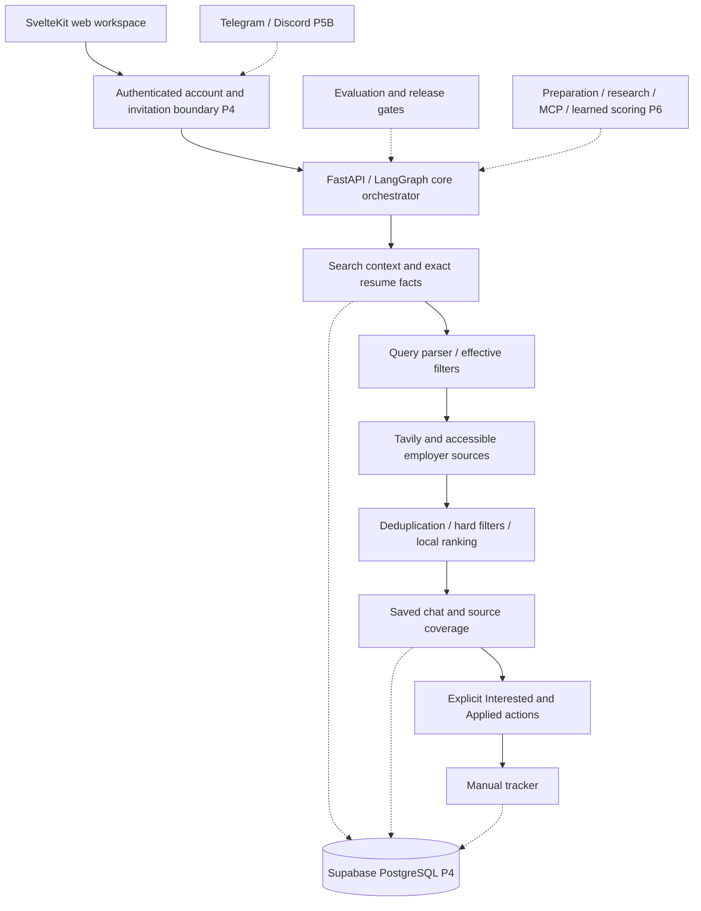

# Career Ops Copilot — Software Requirements Specification (SRS)

**Revision:** 15 October 2026 — core search/tracker release first.

**Document purpose:** Living requirements and phased implementation roadmap. Requirements describe target behavior; implementation evidence lives in `implementation-status.md`. Updating a requirement does not implement or certify it. P1–P3 preparation/scoring experiments remain historical prototypes where explicitly deferred below.

**Phase tags:** `[P1]` local discovery/tracker foundations · `[P2]` query/ATS/content matching · `[P3]` structured facts/history/evaluation · `[P4]` core readiness · `[P5A]` release hardening/deployment/documentation/demo · `[P5B]` Telegram/Discord · `[P5C]` commercial model · `[P6]` optional product upgrades. P5A/B/C are milestones within P5; P5B/C do not block the first deployment.

**Implementation control:** The user authorized starting P4 implementation after the requirements revision. Complete the agreed discovery/quality baseline and continue P4 acceptance; the user subsequently supplied keys and authorized six-resume testing on 16 October 2026; see `testing-2026-10-16.md` for current evidence and remaining gates. Before a new architectural decision, present options, recommend one, and obtain the user's choice. Confirmed decisions do not need repeated approval. Detailed core requirements and decision checkpoints: `../spec/core-release.md`.

---

## 0. Competitive Research Notes

Before specifying requirements, here's what direct competitors do and where this system deliberately differs — this shapes several decisions below.

**Jobright.ai** (~$5M ARR, 9-person team) is the closest existing analog: resume upload → AI match score (70-100%) against aggregated listings → resume tailoring → autofill/autoapply. Independent reviews surface two recurring failure modes worth designing around from day one:
1. **Resume/cover-letter hallucination** — the AI invents experience or locations not in the candidate's background, sometimes producing "confident fiction." This is exactly what the P6 Critic agent (§9.8) exists to catch, and validates that guardrail as a real differentiator, not overengineering.
2. **Score inconsistency across surfaces** — Jobright's Chrome extension sometimes shows a different match score than the main platform for the same job, because scoring is computed separately in each place. **Design principle**: all surfaces (web, Telegram, Discord) must call the same backend scoring logic — never reimplement scoring per client.

Jobright's free tier is widely criticized as too restrictive (exhausted in one session), pushing users hard toward $18-40/month plans with no trial. This system should be more generous on the free tier (§ Monetization below) — not chasing VC-scale revenue, and a fair free tier is a better trust signal and a better interview story than a paywall-heavy one.

Jobright pushes toward full autoapply. **This system deliberately does not** — the manual action gate (§9.9) is a trust-by-design choice, positioned explicitly against the "autoapply produces confident fiction" failure mode competitors are being called out for.

**Resume tailoring competitors** (ApplyTeX, ResumeTailor, VeloCV, Ryusume, JobShinobi) converge on the same technical pattern for format-preserving tailoring: parse a `.tex` source into addressable statements with stable IDs and exact character spans, rewrite only relevant statements grounded in evidence (never inventing skills/employers/metrics), splice edits back into the *original* source, recompile. Notably, even funded competitors either require a `.tex` source upfront or explicitly list PDF-to-LaTeX reconstruction as "planned for a future release" — true reverse-engineering of an arbitrary PDF's exact visual layout into equivalent LaTeX is still an unsolved problem industry-wide, not a gap unique to a student project. This directly informs §7's resume curator design.

**Recommendation-systems research** on cold-start and implicit feedback (matrix factorization, Bayesian personalized ranking, etc.) is built for population-scale, multi-user interaction data — thousands of users generating overlapping signals. That's the wrong tool here: a new product with a modest user base doesn't have the interaction volume those methods need, and using them anyway would be a mismatch between technique and data regime, not sophistication. §"Self-Improving Scoring Design" below explains the lighter-weight approach chosen instead.

---

## Implementation decisions — 16 October 2026

P4 source work is authorized; all tests and real-resume/live-query runs wait for a separate user instruction. Use SQLModel/Alembic/psycopg through Supabase Session pooling with a fresh PostgreSQL workspace and no SQLite import. Use verified UUID account mapping and an operator CLI invitation allowlist; the user manages the addresses. Search execution uses a PostgreSQL queue with one globally leased FastAPI worker, cancellation, saved status and explicit retries. Operational defaults are 5 searches/account/day, 20 globally, 90 global model-call attempts and 60 global Tavily-call attempts per UTC day. Cache public Tavily responses for ten minutes only; fetch descriptions and compute private fit/context/tracker state afresh.

The user selected immediate active deletion without retained application backups. This supersedes draft retention/backup-restore requirements for the current scope; no backup or restore guarantee is claimed. Google and email-link flows are implemented in source; SMTP/domain and actual provider configuration remain pending, with Resend SMTP the approved recommendation. Hosting and measured workload acceptance remain pending. See `p4-operations.md` and `supabase-setup.md`. None of these source changes establishes completed P4 acceptance.

## 1. Introduction

### 1.1 Purpose
Help users find relevant jobs, review source-backed descriptions and match evidence, and maintain their own application tracker. Preparation tools become later, independently validated upgrades.

### 1.2 Release scope
The first production release is a web application for 10–15 invited testers: DOCX resume intake, worldwide technology job discovery with India as a coverage priority, local resume relevance ranking, persistent Search chat with contextual follow-ups, Interested intake, manual tracking, account/privacy controls and operational protection. Accounts must support later public registration without rebuilding ownership or identity.

Telegram/Discord follow deployment in P5B. Pricing, commercial usage allowances and paid feature gates are decided in P5C. Tailoring, curation, interview research, MCP and optional learned scoring are P6 upgrades. An existing prototype is not automatically a released feature.

### 1.3 Out of scope and permanent boundaries
- No automated application submissions. No agent may mark Applied without the user's explicit action and an audit record.
- No unconditional guarantee of every platform, every Indian vacancy, a nonempty result, or hiring success.
- No LinkedIn login/scraping integration in the approved discovery scope. Revisit a refined feature only after measured coverage gaps and user discussion.
- No fabricated qualifications, match evidence, job descriptions or interview claims. The uploaded resume is source evidence, not an authenticity assessment target.
- No exact leaked-interview-question guarantee, full interview coaching or arbitrary PDF-to-LaTeX visual reconstruction.
- No training on user data without separate explicit opt-in. Local learned scoring stays disabled and deferred to P6.

### 1.4 Definitions
**JD:** job description. **ATS:** applicant tracking system. **Fit score:** explained content relevance, not hiring probability. **Query spec:** effective hard filters and soft preferences. **Search context:** the prior successful intent used to resolve follow-ups. **Saved preference:** an explicitly remembered user choice, distinct from resume facts. **Golden dataset:** independently labelled evaluation cases.

### 1.5 Intended audience
The builder and implementers tracking requirements, evidence, release gates and architectural decisions.

---

## 2. Overall Description

### 2.1 Product perspective
Automated discovery should deliver useful jobs inside the application. Manual browsing must not become the primary discovery workflow. Interested and manual application tracking remain user decisions.

### 2.2 Features by release phase
| Feature | Phase / release status |
|---|---|
| Resume-based discovery, exact DOCX facts, chat results, explicit Interested and audited tracking | P1–P3 foundations; P4 hardening |
| Complex queries, ATS retrieval and grounded content relevance | P2 foundation; P4 general location/coverage validation |
| Structured fact consolidation, persisted history and evaluation | P3 foundation |
| Conversational search context and explicitly saved preferences | P4; saved history alone does not satisfy this |
| Google/email-link login, invitation eligibility, isolation, PostgreSQL and privacy | P4 |
| Operational rate/concurrency limits, provider budgets and failure recovery | P4; independent of paid tiers |
| Production deployment, release hardening, monitoring, recovery, documentation, demo video and write-up | P5A |
| Telegram and Discord using the same backend | P5B |
| Pricing, free/paid plans, commercial allowances and paid feature gates | P5C; undecided until that milestone |
| Resume/cover-letter tailoring and preparation critic | P6; existing prototype deferred |
| Format-preserving curation and interview-structure research | P6; existing prototypes deferred |
| Custom MCP server and optional outcome-based learned scoring | P6 |

### 2.3 User classes
- Visitor: public introduction/sign-in information; no access to private workspaces or provider configuration.
- Invited beta user: authenticated, isolated core workspace, without commercial plan distinctions at launch.
- Public registered user: later admission mode using the same ownership model after a readiness check.
- Operator: manages invitations, provider credentials and deployment configuration. Operator workflow/UI is a decision checkpoint, not a required new admin dashboard.
- Free/paid commercial tiers: P5C decisions; no current feature-to-price promises.

### 2.4 Operating environment
Existing FastAPI/LangGraph backend and SvelteKit web frontend. Local inference for embeddings; all generative calls through OpenRouter. Supabase PostgreSQL and Auth are the planned P4 services, starting on the free tier. Hosting is selected with the user after resource/capacity measurement, before P5A. Current SQLite remains a local prototype/development store.

### 2.5 Constraints
- Only free OpenRouter models with tool/function calling; keep provider price/privacy restrictions. Paid product tiers do not authorize paid LLM models.
- Treat user-written resume facts as source truth; preserve exact stored statements for any later preparation. Do not assess plausibility/authenticity.
- Explicit hard filters remain strict; soft preferences affect order, not eligibility. Unknown metadata is not positive evidence.
- Preserve the confirmed light blue Search chat / Job tracker / Settings structure. Discuss further architectural or structural UI decisions before choosing them.
- Use Tavily plus accessible configured/discovered employer sources initially. No JSearch integration is authorized. Respect source access restrictions and bounded requests.
- Existing local data stays intact; beta accounts start empty. No automatic upload or assignment to the first account signing in.
- Free tiers first, with documented limits, resource measurements and an upgrade path. No always-on availability or automatic backup assumption.

### 2.6 Dependencies and decision checkpoints
The user supplies OpenRouter/Tavily keys and later Supabase/OAuth/email setup. Poor Indian coverage blocks beta and triggers a reviewed remedy, rather than an unapproved provider switch. SMTP/email domain, hosting topology/vendor, session mechanism, background execution, backup retention/storage, numerical operational limits and benchmark thresholds must be discussed with recommendations before implementation. No key is pasted into documentation.

Supabase currently offers a $0 PostgreSQL/Auth starting tier; the user's conditional provider choice is therefore Supabase, with Neon only a fallback if that condition ceases to hold and after reviewing the auth replacement. Free inactivity pausing and lack of automatic backups must be addressed in the release runbook. [Pricing](https://supabase.com/pricing). Real email-link delivery needs custom SMTP. [Email setup](https://supabase.com/docs/guides/auth/auth-smtp).

---

## 3. Core User Journey

1. Sign in with Google or an email link; invitation eligibility is enforced on the server. Later public registration reuses this identity path. `[P4]`
2. Upload a valid DOCX on Search chat, inspect extracted source statements, and retain/remove the resume through the confirmed controls. A stored resume is required for the core search flow. `[P1–P3 foundation / P4 acceptance]`
3. Find jobs from the resume alone or add role/location/date/company constraints. Resolve follow-ups such as “same role, but in Delhi,” showing effective filters and offering reset/edit controls. `[P2 / P4 context]`
4. Review ranked, grounded JD cards with source links, known dates and honest availability/coverage notices. Incomplete leads remain separately unscored. Sparse or empty results explain source and eligibility limitations. `[P2 / P4]`
5. Choose Interested to create exactly one tracker application. Search alone never creates an application. `[P1 / P4]`
6. Apply externally, then explicitly click Mark as Applied. Draft preparation is not a prerequisite for recording the user's action. `[P1 / P4]`
7. Manually maintain Interested → Applied → Interviewing → Resolved and outcomes; confirmed removal preserves chat/audit history. `[P4 target]`
8. Return after refresh/login with history, explicit preferences and search context preserved within the account. Resume changes clear stale fit information. `[P3 history / P4 context]`
9. Use account/privacy controls to inspect preferences or delete data. `[P4]`

Bots are P5B. Commercial feature boundaries are P5C. Per-job preparation/research and MCP are P6; they are absent from the first-release UI and denied through its production API.

---

## 4. System Architecture

The diagram is the target release boundary. Current code still uses one local account and SQLite; actual implementation evidence is recorded separately. All later clients use the same identity, orchestrator and ranking behavior. Deferred actions cannot bypass the core feature-availability boundary. Service/session/worker topology is decided with the user before implementation.

---

## 5. Query Understanding and Content Relevance `[P2 / P4]`

The parser produces a validated query spec containing hard filters (explicit technologies, roles, companies, industries, locations and recency) and evidenced soft preferences (e.g. seniority, project-domain similarity). The P4 context resolver interprets follow-ups before merging effective constraints; it never silently invents persistent preferences. The local structured-record implementation is described in `search-context.md`; live interpretation and production account/database acceptance remain pending.

Core ranking uses local semantic similarity between JD and stored resume facts plus supported query preference signals. Resume skills must not all become mandatory filters, and a user need not meet every JD requirement to see a relevant role. Do not infer employer tier/size or hiring probability from missing data. Layer 2 learned corrections are P6.

Show weaker eligible jobs when available. If no source-backed candidate meets mandatory filters, return an honest empty state. Never fabricate vacancies, relax a mandatory location/date/technology requirement, or transform snippets into scored descriptions to make results nonempty. Every fit explanation must reference real resume/query/JD evidence.

Examples retained for parser/evaluation: resume-matched jobs posted this week; junior/intern roles with a stated company-tier preference; roles aligned with stored project domains; Java backend in fintech; named prior employers only when grounded in stored statements. Test unavailable/unknown company-tier evidence honestly. Geography acceptance includes several Indian and international cities, not a Delhi-only branch. The approved offline GeoNames nearby preference defaults to 50 km with same-country broadening: 80% existing relevance plus 20% location credit (full inside, radius/distance outside, zero unknown distance). Explicit distance limits remain mandatory. Clickable inline score details expose actual contributions, evidence and unknowns. See `geography-and-fit.md` for implemented scope and pending strict-city/live acceptance.

---

## 6. Self-Improving Scoring Design `[P6]`

Upgrade status: a consent-gated local prototype exists; learned adjustments stay OFF and are excluded from the core release. Logged tracker outcomes may remain as records without training or changing scores. P6 needs separate release acceptance.

Marked in the original scope as "needs to be figured out completely" — here is the complete design, deliberately scoped to what a single-product, moderate-user-base system can actually support (see §0 for why classical collaborative filtering is the wrong tool here).

**What is NOT used, and why**: matrix factorization / Bayesian personalized ranking / collaborative filtering. These techniques learn from *cross-user* interaction patterns at population scale — they need many users generating overlapping signals to find useful latent structure, and are famously bad exactly in the cold-start regime this product starts in. Using them here would be a mismatch between technique and data volume, not a sign of sophistication.

**What is used instead**: a two-layer scoring model, already introduced in §5.
- **Layer 1 (content-based, day-one usable)**: semantic similarity + structured query_spec signals. Works from a user's very first search, no history needed.
- **Layer 2 (personalized correction, phased in per user)**: as a user logs real outcomes (applied → interview → offer/reject/no-response) through the tracker, a lightweight per-user weighted-adjustment model learns which *structured signals* (company tier, tech-stack overlap type, project-domain similarity, recency) actually correlate with that specific user's positive outcomes, and nudges future scores accordingly. This is closer to online logistic-regression-style feature reweighting than deep collaborative filtering — appropriately small for the amount of labeled data one user will realistically generate in a semester.

**Recalibration cadence**: rather than continuous live gradient updates (unnecessary complexity, harder to debug/explain), personalized weights are recalculated on a scheduled or on-demand basis (e.g. after every N new logged outcomes) — simpler, reproducible, and directly testable by the evaluation harness (§9.14; original P3 prototype evidence is historical).

**Cold start for a brand-new user**: falls back entirely to Layer 1 until enough outcome data exists (a small minimum threshold, e.g. 5-10 logged outcomes) — never attempts personalization on data too sparse to learn from.

---

## 7. Resume Curator — Upgrade Design `[P6]`

The existing prototype is deferred from the core UI and production API. Curation happens only on demand for one selected job, using exact stored statements and verifiable source spans; unsupported data must produce an honest limitation.

For self-contained `.tex` input, address statements by stable IDs/exact spans, plan grounded selections/edits, preserve source outside supported spans, validate through the critic and compile PDF plus `.tex`. Preserve layout with an advisory for columns/tables. For supported non-`.tex` inputs in P6, offer an explicitly labelled clean-template layout instead of promising arbitrary visual reconstruction. The core upload remains DOCX-only; this upgrade does not silently expand intake formats.

Two-JD/source-preservation, compilation, provenance, invalid-source and live-model acceptance remain required before exposing the upgrade. Prior fixture tests establish only their recorded scope.

---

## 8. Clients and Commercial Model `[P5B / P5C]`

Telegram and Discord are P5B thin clients calling the same authenticated core path. Confirm account linking and supported bot actions with the user when that milestone starts. Their completion does not block P5A.

P5C decides pricing, free/paid feature boundaries, commercial usage allowances and paid feature gates. Do not assign core search memory, bots or P6 features to a paid tier in advance. P4 operational protection and global provider budgets apply before any pricing scheme; do not postpone abuse protection to P5C. P5C completion also does not block P5A.

---

## 9. Functional Requirements

### 9.1 Authentication and Accounts `[P4]`
- FR-AUTH-1: Supabase Google and passwordless email-link sign-in; server-enforced invite-only admission for 10–15 testers.
- FR-AUTH-2: Verified account ownership scopes every private operation. No hardcoded local-user fallback in deployed routes.
- FR-AUTH-3: Account deletion removes associated active workspace data and artifacts; document backup-retention/deletion semantics before launch.
- FR-AUTH-4 `[P5C]`: Enforce future commercial entitlements after their boundaries are decided; none are required for P5A.
- Acceptance: unauthorized/uninvited/cross-user requests fail; refresh/logout/login and both sign-in flows work; later public admission needs no identity-model rebuild.

### 9.2 Getting Started `[P1 foundation / P4 hardening]`
- FR-START-1: Core search requires a stored resume. Add resume (.docx), current filename/remove ×, and explicit non-DOCX validation remain inline in Search chat.
- FR-START-2: Extract exact source-backed statement IDs/text/spans for ranking. Failed replacement preserves the last valid resume; do not assess authenticity.
- FR-START-3: A separate structured onboarding profile form remains deferred.

### 9.3 Query Parser `[P2 / P4]`
- FR-QUERY-1: Parse validated hard filters and evidenced soft preferences.
- FR-QUERY-2: Mandatory filters never relax; soft preferences never become eligibility cutoffs.
- Acceptance: independently labelled query examples, ambiguous follow-ups, mandatory overrides and general geography. Context requirements are in §9.13.

### 9.4 Scout `[P1/P2 foundation / P4 coverage]`
- FR-SCOUT-1: Preserve the core search contract and job provenance described in §12.
- FR-SCOUT-2: Use accessible ATS JSON before permitted static/rendered fallback, within supported access and resource budgets. Tavily supplements configured and discovered employers.
- FR-SCOUT-3: Canonicalize/deduplicate before caps and exclude only the user's active tracker jobs; preserve distinct requisitions and source attribution.
- Acceptance: live Indian and international coverage benchmark including non-seed employers; partial/quota failures and incomplete leads remain honest. Poor Indian coverage blocks beta and requires user-reviewed remediation. No JSearch integration or LinkedIn scraping is authorized.

### 9.5 Ranking `[P2 / P4; learned adjustment P6]`
- FR-RANK-1: Score eligible source-backed descriptions using the current resume and supported query signals.
- FR-RANK-2: Keep lower soft matches; when the eligible pool is empty, report coverage/filter failures without inventing results.
- FR-RANK-3: Provide grounded explanations and mark unknown metadata. Fit is not a hiring probability.
- Acceptance: zero mandatory-filter violations or invented evidence; test weak eligible results separately from truly empty mandatory-filter cases.

### 9.6 Tailor `[P6]`
- FR-TAILOR-1: Resume/cover-letter preparation is on demand for a single chosen job, using exact stored statements.
- FR-TAILOR-2: Output is a draft and never marks Applied. Existing prototypes stay dormant until P6 release acceptance.

### 9.7 Resume Curator `[P6]`
- FR-CURATOR-1: Preserve `.tex` source outside supported statement spans (§7).
- FR-CURATOR-2: Label a clean-template layout honestly for supported non-`.tex` input.
- FR-CURATOR-3: Provide validated PDF/`.tex` outputs only after provenance and compile checks.
- Acceptance: independent two-JD/source-preservation and actual model/rendering checks; no core UI/API exposure before acceptance.

### 9.8 Preparation Critic `[P6]`
- FR-CRITIC-1: Validate every prepared claim against exact stored facts.
- FR-CRITIC-2: Any proposed contribution to fit scoring is separately explained and tested as part of the upgrade.
- A dormant/failed draft must not prevent the core tracker from recording that the user applied externally. Source-grounding for core extraction/ranking remains mandatory in P4 without requiring this preparation node.

### 9.9 Human Action Gate `[P1 / P4]`
- FR-GATE-1: Applied requires an explicit user action and corresponding audit record. Enforce this in the deployed database/application paths, including concurrency and attempted bypasses. It never submits an application externally.

### 9.10 Tracker `[P1 foundation / P4 four-stage release]`
- FR-TRACK-1: Interested → Applied → Interviewing → Resolved. Only explicit Interested creates an application; updates/outcomes are manual.
- FR-TRACK-2: Keep responsive Kanban/list views and confirmed removal/restore preserving chat/audit history.
- Acceptance: search creates zero applications; duplicate intake does not reset progress; stage changes survive reload; audit legacy Tailored → Interested while retaining preparation artifacts and Applied/later progress.

### 9.11 Interview Research `[P6]`
- FR-IR-1: `research_interview_structure(company: str) -> InterviewStructure` on demand.
- FR-IR-2: Explain supported round structure and example themes/difficulty; never invent exact questions.
- FR-IR-3: Fixed evidence retrieval, provenance validation, shared public-research cache and honest insufficient-data behavior. No user-private content in shared cache.

### 9.12 Orchestrator `[P1 foundation / P4 boundary]`
- FR-ORCH-1: Core routes query/context, discovery, ranking and tracking; only its explicit gate records Applied. P6 routes are disabled for the core production release, even if prototype functions exist.
- Acceptance: the core journey completes without invoking preparation; hidden/deferred actions cannot be called directly through production endpoints.

### 9.13 Memory `[P3 facts/history / P4 conversational context / P6 learned weights]`
- FR-MEM-1: Consolidate exact resume facts and explicit outcome records by stable source identity with add/update/delete semantics. Outcome storage does not authorize learning.
- FR-MEM-2 `[P6]`: Store learned weights only after explicit consent and upgrade acceptance; default remains OFF.
- FR-CTX-1–4 `[P4]`: Account-scoped active intent and explicit saved preferences, follow-up resolution, visible effective filters, correction/removal/reset, and stale-resume invalidation. See `../spec/core-release.md` for precedence and failure acceptance.
- Saved ChatTurn snapshots alone do not satisfy conversational memory requirements.

### 9.14 Evaluation `[P3 foundation / P4 release gates]`
- FR-EVAL-1: Independently labelled tool/spec and ranking checks, with a fixed live discovery benchmark alongside fixtures.
- FR-EVAL-2: Distinguish weak soft matches from impossible hard filters; test no fabrication and no mandatory relaxation.
- Acceptance: separate fixture, live-provider, live-model, PostgreSQL and deployed evidence. Agree numerical relevance/coverage thresholds before evaluating the release. Skips/pending credentials are not passes.

### 9.15 MCP `[P6]`
- FR-MCP-1: Expose approved search/JD/resume-fact/research tools through the authenticated backend after a separate tool-permission and acceptance review. No MCP requirement blocks core deployment.

### 9.16 Additional Clients `[P5B]`
- FR-BOT-1: Telegram/Discord use the same identity, query, scoring and tracker path; agree account linking and commands before implementing. Manual Applied rules hold on every surface.

### 9.17 Commercial Model `[P5C]`
- FR-RATE-1: Decide and implement commercial usage allowances after pricing/tier decisions.
- FR-RATE-2: Paid feature gates use those reviewed entitlements. No predetermined price table or paid bot/P6 promise.

### 9.18 Privacy `[P4]`
- FR-PRIV-1: User-triggered deletion covers resume, history, context, preferences, tracker and associated private artifacts; agree backup-retention semantics.
- FR-PRIV-2: Plain privacy notice at signup/intake explains storage, external processing, deletion and known service limits.
- FR-PRIV-3: No user-data training without separate explicit opt-in. Do not log raw resumes, keys or authentication tokens.

### 9.19 Production Persistence and Operational Protection `[P4 / P5A]`
- Use Supabase PostgreSQL with versioned migrations and verified ownership on every resource. Preserve Applied audit enforcement beyond SQLite triggers. Deployed beta starts empty.
- Bound source/model calls, concurrency, retries and global credit consumption before launch, independently of commercial tiers.
- Persist search execution status for refresh/reconnect/retry and interrupted work; avoid duplicate turns/applications.
- Require health/readiness, monitoring, backup restore and deploy rollback acceptance. Discuss hosting, session/worker/backup architecture and numerical capacity limits with the user before choosing them.

---

## 10. UI/UX Requirements

### 10.1 Core workspace `[P4]`
Keep Search chat, Job tracker and Settings, continuous saved conversation, inline DOCX controls and collapsible JD/fit cards. Add effective-context/reset and explicit preference management without a speculative separate assistant/profile page. Ordinary users see no secrets/global configuration.

Remove deferred preparation, learning, MCP and unfinished-feature controls from the target core UI. Hide current manual LinkedIn buttons initially and revisit a refined feature only if discovery evidence requires it. Preserve desktop/mobile accessibility and clear loading/error/empty/partial states. Existing runtime UI is unchanged until the implementation step.

### 10.2 Introduction and Login `[P4 / P5A release]`
Explain the actual core pipeline: search → Interested → Applied → Interviewing → Resolved. Offer Google and passwordless email-link sign-in, invitation eligibility, error/loading states and privacy information. A demo must show released behavior rather than deferred tools. Final structural UI choices are discussed with the user.

---

## 11. Data Responsibilities

Detailed model requirements: `../spec/data-models.md`. Retain existing private entities and source evidence; P4 adds authenticated identity/admission, conversational context/preferences and persistent execution state. Every private entity has an accountable owner. Use PostgreSQL migrations; do not mistake configurable SQLAlchemy URLs for a completed production migration.

Preparation artifacts, research cache and learned weights belong to P6 and can remain dormant historical data. Preserve local history and later stages during any stage migration. Beta starts empty; future local-owner import needs explicit approval.

---

## 12. Interfaces and Contracts

- Core retrieval retains `search_jobs(query_spec: dict, limit: int = 10) -> list[dict]` internally, with source/description evidence and explicit coverage/failure metadata in the orchestrator response. User identity is derived from verified authentication, never trusted from arbitrary request fields.
- P4 public operations cover resume intake/removal, context/preferences/history, search execution/result retrieval, explicit Interested, explicit Applied, manual tracking and account deletion. Define exact wire shapes and compatibility with the user during implementation; this revision does not select session or worker architecture.
- Publish centralized feature availability consistently to UI and backend; dormant P6 routes are denied in production.
- OpenRouter remains the only LLM gateway, restricted to free tool-capable models. Provider keys and service credentials remain server-side.
- Interview-research contract and MCP tools are P6; bot clients are P5B. No alternative client bypasses ownership, budgets or action gates.

---

## 13. Non-Functional Requirements

### 13.1 Performance and Capacity
Target 10–15 invited accounts. Measure embedding/browser memory, warm latency, cold starts, concurrent search workload and provider credits on the proposed host. Agree workload/limits with the user; do not claim tested capacity or always-on uptime before evidence exists.

### 13.2 Cost
Free tiers first; keep a documented upgrade path. Operational budgets and abuse controls are P4. Pricing and commercial per-user entitlements are P5C. Provider limits must be rechecked at setup; exhausted services produce explicit partial/unavailable results.

### 13.3 Security and Privacy
Enforce authentication, invitation eligibility, ownership, safe public fetching, bounded uploads, private artifact access, no-secret logs and explained deletion. Validate cross-user IDs and direct API bypass attempts, not only UI visibility. Discuss unselected security/session/storage architecture before implementation.

### 13.4 Reliability
Use honest source/error/empty states, durable search progress, idempotent actions, tested PostgreSQL migrations, restore and rollback. Do not broaden mandatory filters or use synthetic results to hide failures. Poor Indian coverage blocks beta.

### 13.5 Usability
Keep a focused, accessible mobile/desktop search-and-tracker workflow. Do not expose dormant tools as working features. History and explicit application progress remain understandable across refresh and resume changes.

### 13.6 Maintainability
Keep modules behind clear contracts, centralized feature availability, and one authenticated core path for future clients. Preserve historical test evidence without representing it as a completed new release gate.

---

## 14. Phased Roadmap and Release Gates

| Phase | Responsibility and completion gate |
|---|---|
| P1 | Local discovery/tracker foundations; historical preparation experiments are retained as prototypes, with release ownership moved to P6 |
| P2 | Query, ATS retrieval and Layer 1 matching; historical curation/research prototypes move to P6 release ownership |
| P3 | Structured facts, saved history and evaluation; historical learned scorer is OFF and deferred to P6 |
| P4 | Core readiness: live Indian/worldwide discovery evidence, conversational search memory, four-stage focused UI, Supabase accounts/PostgreSQL, isolation, privacy and operational protection; owning acceptance in `../spec/core-release.md` |
| P5A | First deployment after P4 acceptance: final release hardening, invited beta, monitoring/restore/rollback verification, documentation, demo video and write-up |
| P5B | Telegram/Discord through the same authenticated backend; follows P5A independently of monetization |
| P5C | Decide and implement pricing, free/paid boundaries, commercial allowances and paid feature gates; follows P5A and does not require P5B completion |
| P6 | Individually validated upgrades: tailoring/cover letters and critic, curation, interview research, MCP, optional learned scoring |

Execution order: reconcile documentation → validate discovery → context/tracker/UI hardening → accounts/PostgreSQL/isolation/operations → P4 acceptance → P5A deploy → separately scheduled P5B/P5C and P6 upgrades. P5B/C are milestones in P5, not additional phases. No later feature is a prerequisite for the core release.

Poor Indian coverage, mandatory-filter violations, fabricated evidence, failed ownership/audit controls or unresolved persistence/recovery failures block beta. Review measured coverage and numerical pass thresholds with the user before declaring acceptance. Fixture success, skipped live checks and a frontend production build are insufficient.

Tasks: `../tasks/phase-4-tasks.md`, `../tasks/phase-5-tasks.md`, `../tasks/phase-6-tasks.md`. P1–P3 lists retain historical context; new release work follows the revised gates.

---

## 15. Decisions Still Requiring Discussion

Before implementing each affected subsystem, recommend options and obtain the user's choice for:
- Hosting vendor/topology and resource plan, based on actual embedding/browser needs and free-tier limits.
- SMTP provider/domain and OAuth configuration for Google/email-link delivery.
- Session/token and invitation-management mechanisms; background execution/recovery design.
- Backup storage/retention, deletion guarantees and operational/concurrency limits.
- Fixed live benchmark contents, numerical coverage/relevance thresholds and acceptable cold-start/performance targets.
- Any remedy if Tavily is inadequate; refined LinkedIn tooling or another jobs API is not automatically authorized.
- P5B account linking/commands; P5C pricing, allowances, entitlements and payment handling.
- Per-upgrade P6 exposure, dependencies and live acceptance. No dormant prototype is released merely by restoring its button.
