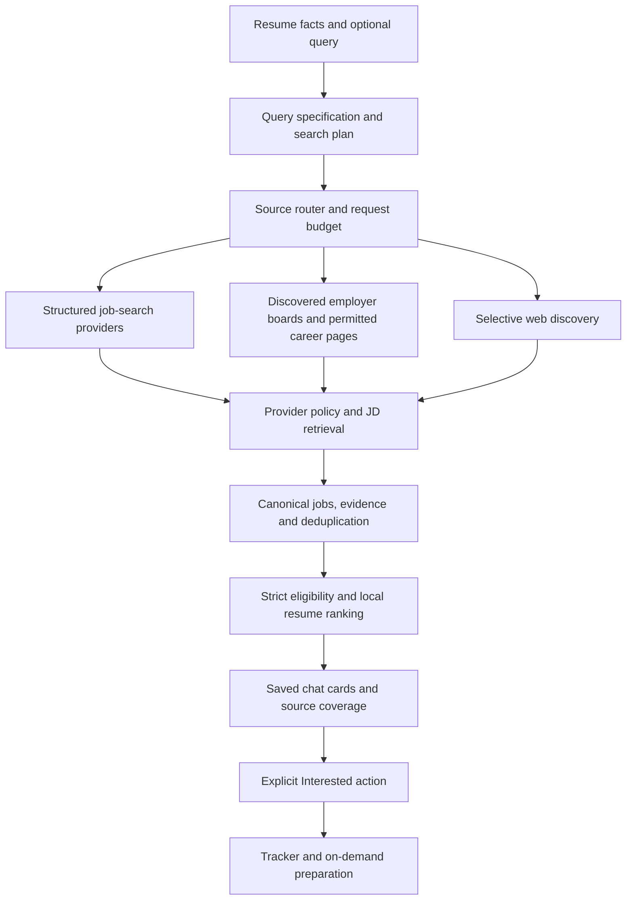

# Job discovery and connected profiles: architecture proposal

Research date: 11 October 2026. Status: decision proposal; this document does not authorize or implement a new integration. Provider findings are from public documentation, not approved contracts or live coverage tests.

## Recommendation

Make option 1, automatic discovery across multiple sources, the core product. Add the useful parts of option 2 as optional capabilities where a platform supports them. Account connections must never be a prerequisite for public job discovery. Every retrieved job enters one normalization, deduplication, eligibility and ranking pipeline and appears in the existing Search chat.

The product promise should be: Career Ops finds and compares relevant jobs across supported sources, explains coverage and match evidence, and lets the user choose what to prepare and apply for. Complete access to every platform is not an achievable default promise with the documented integrations reviewed here.

## SRS alignment and decisions that take precedence

Relevant SRS sections: 1.1–1.3 (purpose and boundaries), 2.2/2.5 (features and access constraints), 3 (journey), 9.3–9.5 (parser, scout and ranking), 9.6–9.9 (preparation and approval), 9.16/9.18 (clients and privacy), and 13.3 (data isolation). Module references: `spec/scout-agent.md`, `spec/architecture.md`, `spec/tracker-ux.md` and `spec/later-phases.md`.

- The SRS already places automated discovery before job review and preparation. Option 1 extends the scout and fits that structure.
- Its multi-platform feature means web, Telegram and Discord clients. LinkedIn/Indeed account connectors and profile publishing are additional features, not existing requirements under that heading.
- Current confirmed decisions override older SRS wording: Search chat is continuous and saved; results are chat cards; only Interested creates applications; Found has become Interested; resume intake is DOCX only for now; only free OpenRouter tool-calling models are allowed; local outcome learning remains off. Fit scores describe content match, not hiring probability.
- The old resume-optional onboarding, paid-model allowance and Found journey should be reconciled in a future SRS revision with the current confirmed workflow. This proposal preserves the current resume-based workflow without reopening those UI decisions.
- The SRS's unconditional nonempty-result acceptance conflicts with strict hard filters when the eligible candidate pool is empty. Proposed wording: show weaker relevant candidates when they meet every mandatory filter; when no eligible verified job exists, show an honest empty state with coverage and failures. Never manufacture vacancies or relax required location, company, technology or recency.
- Discovery improvements can extend the current P1–P3 scout. Secure external accounts, broader public account infrastructure and profile publishing need a separately approved phase extension; P4/P5 are not implemented by this proposal.

## Research: what each connection can actually provide

| Resource | Documented access | Consequence for this app |
|---|---|---|
| LinkedIn self-service sign-in | OIDC supplies basic identity information. Additional API capabilities require their own permissions; most partner permissions require approval. | A successful sign-in does not establish full career-profile import, profile editing or general job-search access. Enable each capability only after verifying access. [OIDC](https://learn.microsoft.com/en-us/linkedin/consumer/integrations/self-serve/sign-in-with-linkedin-v2), [permissions](https://learn.microsoft.com/en-us/linkedin/shared/authentication/getting-access). |
| LinkedIn talent integrations | Job Posting APIs serve approved integrations that publish/manage employer jobs; the Profile API is also restricted. | These are not evidence of a self-service job-seeker search/profile-write integration. Seek specific partner capabilities or discover indexed leads and employer copies. [Job Posting API](https://learn.microsoft.com/en-us/linkedin/talent/job-postings/api/overview), [Profile API](https://learn.microsoft.com/en-us/linkedin/shared/integrations/people/profile-api). |
| Indeed | Partner APIs manage job postings, employers and candidates. A Publisher JavaScript Plugin displays a supplied subset of Indeed PLUS jobs, needs partner access and HTTPS, and renders provider cards. | There is an official display route, but the reviewed documentation does not establish raw JD delivery for our own backend ranking, or India eligibility. Confirm both with Indeed before promising a native connector. A widget alone does not satisfy the single-scoring-pipeline requirement. [API catalog](https://docs.indeed.com/api-guides), [publisher plugin](https://docs.indeed.com/indeed-plus/publisher-js-plugin). |
| Greenhouse and Lever | Greenhouse GET job-board data needs no authentication. Lever publishes jobs under employer board/site identifiers and exposes JSON postings. | Strong direct-JD retrieval sources; neither supplies one global search over all employers. We must discover and maintain board URLs dynamically. [Greenhouse](https://docs.greenhouse.io/job-board.html), [Lever](https://github.com/lever/postings-api). |
| Adzuna | Search supports India (`in`), keyword/location/distance/age filters and job coordinates. The standard response describes JDs truncated to 500 characters. Default limits include 250/day and 2,500/month. Terms specify attribution and may require licensing for other organizational uses after a trial. | Candidate for structured India discovery, conditional on intended-use approval and an answer about complete-JD access. Preserve required redirect/attribution behavior; do not assume automatic external enrichment is permitted. [API schema](https://developer.adzuna.com/swagger/spec/test2.json), [terms](https://developer.adzuna.com/docs/terms_of_service). |
| Tavily | General web discovery; currently 1,000 free credits/month. Basic searches cost one credit. | Use selectively to discover new employer boards and missing openings. Its search coverage is not a complete job database. [Pricing](https://www.tavily.com/pricing), [search endpoint](https://docs.tavily.com/documentation/api-reference/endpoint/search). |
| Jooble | Regional keys; current free allowance is 500 lifetime requests/key. | Optional trial/secondary aggregator rather than the long-term free foundation. [Documentation](https://help.jooble.org/en/support/solutions/articles/60001448238). |
| Remotive | Public remote feed, attribution/backlink requirements, a 24-hour display delay, advice to fetch at most four times/day, and restrictions on collecting signup/email details to show listings. | Conditional remote supplement. A future authenticated/gated product must confirm suitable licensing rather than assuming public-feed terms fit it. [Provider documentation](https://github.com/remotive-com/remote-jobs-api). |

User authorization and platform authorization are separate dependencies. Signing into a platform cannot expand the scopes that platform grants our application. LinkedIn also prohibits unauthorized scraping/automation; using a user's session does not establish an approved integration. [LinkedIn guidance](https://www.linkedin.com/help/linkedin/answer/a1341543).

Third-party providers claiming LinkedIn/Indeed coverage require a trial and an explicit check of distribution rights, attribution, retention, region coverage, complete descriptions and publication-date quality. A provider's marketing claim alone is insufficient to label an integration native or exhaustive.

## Option 1 completed: automatic discovery across multiple sources

### User journey

1. Upload the resume once; optionally enter a query and preferred location.
2. Click Find jobs. Search starts without connecting job-site accounts.
3. Results arrive in Search chat with collapsible JD/fit details, source attribution, location and known publication/verification dates.
4. Interested adds an application; preparation actions remain on demand in the tracker. Applying remains the user's explicit action.
5. Show which sources were checked, which failed/reached quota, and which returned only incomplete leads. The user can choose optional sources in Settings, without a setup step for each search.

### Backend flow

### Responsibilities

- Search planner: derive alternative role/skill retrieval queries from stored resume evidence and explicit instructions. User filters remain distinct from retrieval keywords; possessing every resume skill is not a job requirement. Generative calls remain through free tool-calling OpenRouter models.
- Source registry/router: record country/region coverage, available capabilities, credential status, description completeness, policy/attribution requirements, quotas and health. Choose adapters by requested geography and job type. Do not treat an employer list as the definition of searchable coverage.
- Employer discovery: locate career/ATS URLs, verify board identities and cache a revisitable employer directory. Expire or revalidate stale endpoints. Seed boards are optional supplements. Scraping/rendering follows the SRS's robots and reasonable-rate requirements; API use follows provider terms.
- Aggregator adapters: map the query to provider filters, page fairly within the budget, preserve provider IDs and required outgoing links. A provider's updated timestamp must not be relabeled as first publication.
- Location resolver: represent country, locality, coordinates, work arrangement and any stated remote eligibility. Use provider coordinates/geo lookup and explicit radius for nearby searches. Replace Delhi-specific expansion with a general location model; disclose an initial nearby radius and resolve ambiguous cities. Unknown locations cannot satisfy required locations.
- JD retrieval: use supported ATS detail endpoints or permitted structured/pages. Store evidence and retrieval time. Detect expiry/closed indications where supported. Return unavailable/unknown rather than claiming a live page proves an opening exists.
- Normalization: preserve a full/partial/missing description flag, known vs unknown field values, and field source URLs. Preserve multiple source occurrences for the same vacancy.
- Deduplication: prioritize employer requisition ID, provider ID and canonical employer URL. Use title/company/location similarity only to propose uncertain duplicates; different requisitions must not collapse merely because their titles match.
- Ranking: use a single scorer across all sources/clients. Enforce mandatory filters, then rank partial skill matches. Unretrieved JDs remain unscored leads; partial descriptions must be visibly limited rather than presented as complete evidence. Active tracked jobs are excluded from discovery without deleting their source history.
- Execution/cost: bound parallel workers, per-host requests, pages and retries; respect provider Retry-After/rate limits; cache within each provider's rights/retention rules. Recheck original descriptions when needed. Return partial results plus source status when one provider fails; quotas never silently trigger paid calls.

### Strengths and limits

This supplies the product's immediate value: the app performs broad retrieval and comparison without requiring the user to browse each source. Public data access requires less user credential handling. Coverage depends on enabled providers and employer discovery; no result count can prove all platforms were searched. A free prototype can be useful, but unlimited, fresh, complete multi-platform coverage is not a defensible budget promise.

## Option 2 completed: optional accounts, profile assistance and supported personal feeds

### User journey

1. Search works before any connection.
2. In optional Connections settings, show what each supported integration grants: basic identity, career-profile import, saved jobs/alerts, job search or profile updates. Show unavailable capabilities explicitly.
3. Connect via a supported OAuth/partner flow, or import a user-exported profile where appropriate. A URL alone does not establish readable profile data. Do not collect platform passwords/session cookies as an account integration.
4. Keep imported profile statements separate from resume facts. Show differences; the user chooses what becomes part of the current matching profile. Do not assess authenticity or silently overwrite resume evidence.
5. On the user's request, prepare platform-specific profile drafts by selecting/arranging supported stored statements. Show the existing text, proposed text and fact provenance. Profile improvements aim at clarity/relevance; no guarantee of improved platform recommendations or recruiter response is implied.
6. Publish a reviewed draft only where a documented write capability and application approval exist, and only after explicit approval of that exact change. Otherwise provide copy/export. No supported writer means no automatic profile update.
7. If job feed/search/saved-job access is separately supported, fetch it automatically and merge candidates into option 1's pipeline. Optional forwarded job-alert ingestion can supply leads; snippets require permitted JD retrieval before scoring. Neither profile curation nor connection completion blocks public search.
8. Show connection expiry/revocation/errors and a working Disconnect/delete-imported-data path. Continue public discovery when a connector fails.

### Backend components

- Connection manager: provider capabilities, user authorization, scope checks, encrypted tokens, refresh/revocation, retention and tenant ownership. Account data stays user-scoped, never in a shared public cache.
- Profile snapshots: source, import time, external identifier where permitted, exact statements/offsets, user-accepted fact mappings and version history.
- Profile curator: on-demand grounded drafts, original/new values, evidence IDs and independent provenance validation. No invented skills, employers, dates, metrics or seniority.
- Profile publisher: capability-gated writes, explicit reviewed-patch approval, idempotency, conflict/version checks and audit records. Do not describe a write as reversible unless the provider supports restoration.
- Personal feed adapters: supported saved jobs/search/alerts/export paths feeding the common source-normalization pipeline. Alert ingestion is an enhancement, not an equivalent replacement for broad search.

### Strengths and limits

This can improve onboarding and consolidate additional evidence and saved/alerted opportunities. It also introduces scopes, token security, account lifecycle, field mapping, synchronization conflicts and platform-specific support. For LinkedIn/Indeed, the publicly documented self-service capabilities reviewed do not establish the combined profile-read/profile-write/job-search promise. It cannot be the dependency on which basic product usefulness rests.

## Shared structure and contracts

Public discovery and private connectors share one output contract, not one credential store. Suggested entities:

| Entity | Purpose / essential fields |
|---|---|
| SourceProvider | adapter, regions, capabilities, quota/rate policy, attribution, permitted retention, health |
| EmployerBoard | employer identity, careers URL, ATS/site token, discovery evidence, last validation |
| SearchRun / SourceRun | user/chat turn, structured filters, role queries, provider status, requests/pages, exclusions, elapsed time, partial failures |
| CanonicalJob | employer/requisition identity, title, full/partial JD, location/remote scope, publication/expiry if known |
| JobOccurrence | provider/external ID, source/detail/apply URLs, source timestamps, field provenance, description completeness, last check |
| MatchSnapshot | resume version, query version, scorer version, score and grounded explanation for a chat result |
| UserConnection | user/provider, granted capabilities/scopes, encrypted credential reference, expiry, revocation |
| ProfileSnapshot / ProfileDraft | exact source statements, user acceptance, proposed changes with evidence, approval/publication audit |
| Application | current Interested-to-Resolved progress, unchanged explicit Applied gate; private to user |

Keep the current scout contract as a compatibility wrapper. Provider adapters should expose capabilities, search, detail fetch and status checks where supported, returning normalized results plus pagination and explicit failure status. A missing capability produces Unsupported, not an invented response. The connection manager selects a user credential only for a supported private operation. Public provider configuration is an operator/BYOK deployment choice, not the same thing as connecting a user's job-site account.

## Comparison

| Criterion | Option 1 as core | Option 2 as core |
|---|---|---|
| Finds jobs without browsing platforms | Strong fit | Dependent on each account API's actual search/feed permissions |
| Matches current SRS and approved chat | Direct scout extension | Adds external-profile/account modules |
| Onboarding | Resume/query; sources handled by backend | More account setup, scope approval and possible reconnection |
| LinkedIn/Indeed dependency | Partial indexed/employer coverage until approved data access exists | Sign-in alone does not resolve data access |
| Profile improvement | Optional later module | Useful when supported, but does not supply discovery by itself |
| Running cost | Retrieval credits, caching, bandwidth and compute | Those same costs plus connector maintenance; connection is not a free-data workaround |
| Failure isolation | One source can fail while others supply results | Revoked/unsupported account access can eliminate the core feed |
| Best product role | Main job-finding engine | Optional profile/personal-feed enhancement |

## Proposed delivery sequence

1. Define source and job-occurrence contracts, truthful coverage/error states, exact/nearby/remote geography, and provider policy boundaries.
2. Evaluate structured India discovery (Adzuna first candidate) for allowed use, real regional coverage and full-JD needs. Use small representative trials before committing a provider; no API is assumed configured today.
3. Expand dynamic employer discovery and direct JD retrieval. Keep Tavily as a bounded discovery supplement and use permitted source caching to reduce repeated search credits.
4. Merge sources into one ranking/chat path. Keep manual imports as secondary tools; a separate manual LinkedIn search is not the main job-finding workflow.
5. Add supported account/profile connections only after separate scope approval and capability verification. Make import/draft and external publishing separate acceptance milestones.

If strict zero-spend is required, prioritize permitted public ATS/career data plus the existing bounded free search tier; clearly show coverage. If direct complete LinkedIn/Indeed data is a must-have, obtain approved distribution/full-JD access before claiming that requirement is met. Those are provider-access decisions, not details that a larger prompt or an MCP wrapper can solve.

## Acceptance and evaluation plan

- Discovery: searches return merged source results without any connected platform account and without requiring the user to browse manually. Validate representative resume/query/location cases against live data; inspect direct versus indexed coverage separately.
- Capability honesty: LinkedIn identity-only auth never unlocks profile-write/search features. Indeed display-only access never masquerades as raw backend candidates. Unsupported/expired/revoked connectors have specific states and public discovery still operates.
- Evidence: scored cards have sufficient stored source JD evidence; known closed jobs are excluded; updated timestamps cannot satisfy publication recency; incomplete descriptions and unknown fields are disclosed. No fake listings to satisfy an empty-result requirement.
- Deduplication: one employer vacancy seen on several platforms appears as one job with source occurrences; distinct requisitions remain distinct. Existing Interested/Applied progress survives rediscovery and reimport.
- Geography: parameterize exact/nearby/remote tests over several countries/cities; nearby uses a disclosed radius and coordinates/provider location capability, not city-specific alias expansion. Ambiguous and unavailable location evidence is handled explicitly.
- Budgets/resilience: cache hits avoid search credits; provider quotas/timeouts/rate limits return partial results and statuses; retries/pages cannot exceed a configured budget; no paid fallback or cap evasion.
- Profile assistance: selection/drafts contain only accepted stored evidence; contradictory imports require user resolution; no write occurs until an exact reviewed patch is approved; revocation/deletion isolates account data.
- UI/persistence: one Find jobs action, chat-only discovered results, collapsible JD, explicit Interested, later tracker preparation and explicit Applied. Refresh preserves chat and progress. Optional connectors are not an onboarding gate.
- Benchmark: compare relevant jobs in the top 10, unique verified jobs per search, source/location/freshness correctness, duplicate/closed rates, description completeness, latency and credits per useful verified job. API success or raw job count alone is not product acceptance. Test fixtures remain isolated; live searches never submit applications.

## Decision to take forward

Approve option 1 as the core and option 2 as an optional, capability-gated extension. Confirm integration rights and regional/full-description coverage through trials before selecting an aggregator contract. Update the SRS language and acceptance criteria after the architecture decision; this research does not claim new source access or change application behavior.
