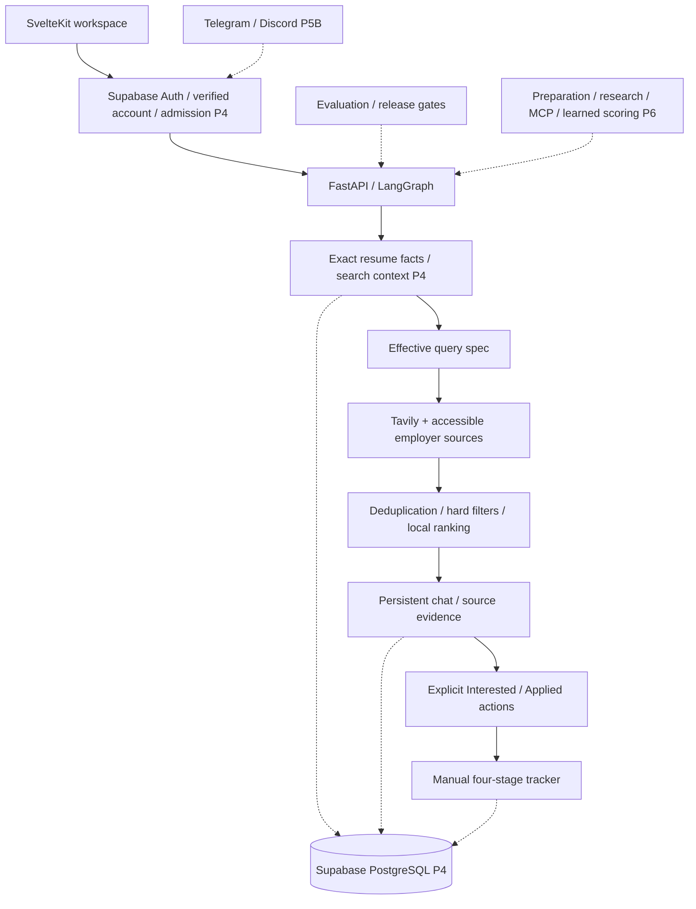

# Architecture and phase ownership

Revised 15 October 2026. The approved first release is search and tracking; these are target boundaries, not a report that P4 already exists. Owning release requirements: `core-release.md`; current evidence: `../docs/implementation-status.md`.

All clients use the same authenticated ownership, query, ranking and action gates. No later feature blocks first deployment. The local prototype still has SQLite, hardcoded user 1 and preparation controls; changing this specification does not change that runtime.

## Phase map

- P1: local discovery/tracker foundations. Original tailoring/critic experiments are historical prototypes; their release is P6.
- P2: query, ATS and Layer 1 relevance. Original research/curation experiments release in P6.
- P3: structured facts, persisted history and evaluation. Learned scoring prototype stays OFF and moves to P6 release ownership.
- P4: core hardening, live India/worldwide coverage, contextual search, focused UI, Supabase accounts/PostgreSQL, privacy, isolation and operational protection.
- P5A: final release hardening, deployment, monitoring/restore/rollback verification, documentation, demo and write-up.
- P5B: Telegram/Discord; P5C: pricing, commercial allowances and paid feature gates. Both follow P5A without blocking it or requiring one another.
- P6: separately accepted tailoring, cover letters, curation, research, MCP and optional learned scoring.

## Ownership

Core release and production gates → `core-release.md`; routing/action gate/intake → `orchestrator-and-gate.md`; discovery → `scout-agent.md`; query/scoring → `query-and-scoring.md`; chat/tracker/UI → `tracker-ux.md`; data responsibilities → `data-models.md`; phase/upgrade contracts → `later-phases.md`. P6 preparation requirements remain in `tailor-and-critic.md`, `resume-curator.md` and `interview-research.md`.

## Architecture decisions

Confirmed: retain FastAPI/LangGraph/SvelteKit, local embeddings, free OpenRouter tool models, Tavily/employer discovery and Supabase PostgreSQL/Auth starting free. Discuss hosting topology, SMTP, sessions, invitation administration, execution workers, backups and numerical limits with the user before choosing or implementing them. No implicit architecture authorization follows from a roadmap task.
